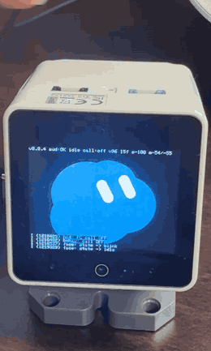
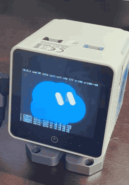

[English](README.md) | [日本語](README.ja.md)

# stackchan-desk-voice

Unofficial fan-made firmware that turns an M5Stack StackChan (CoreS3) into a USB microphone and speaker for your PC, with an animated cloud face. Tap the head twice to start or stop a voice call in a desktop AI chat app.

This is not an official M5Stack or Stack-chan project. See [Disclaimer](#disclaimer).

| Double-tap the head: the call starts and the eyes change | The eyes move first, then the head turns |
|---|---|
|  |  |

## Features

- The StackChan shows up on the PC as a USB Audio Class 2 microphone and speaker: 48 kHz, 16-bit, mono in each direction.
- A double tap on the head sensor sends a USB keyboard key (F13 by default). The PC script turns that key into a click on the app's voice button.
- While a call is active, the PC script turns on the Scroll Lock LED. It tells whether a call is active by looking at the app window, so keep that window open, not minimized. A minimized window reads as "no call". The firmware reads that LED report and changes the face, so the device keeps up even when you end the call from the app. When the call ends, the speaker plays a short beep.
- The face is drawn in code: a blue cloud with two white capsule eyes. It switches between idle, blink, listening (your voice on the mic), thinking (just after you stop talking), speaking (sound from the PC), petted (when you stroke the head), sleepy (3 minutes with nothing happening) and sleep (10 minutes).
- Touch the screen and the eyes follow your finger. They stay there for a second after you let go.
- While idle, the neck servos turn the head every 20 to 30 seconds. The eyes move first and the head follows. The movement stops as soon as someone speaks.
- During the idle look-around moves, the mic sends silence from shortly before the servos move until shortly after they stop, so motor noise stays out of the call. The USB stream keeps running. The position hold at boot and the re-hold after you move the head by hand are not muted.
- If you push the head by hand, the servo lets go instead of fighting you, then holds the new position.
- The last few log lines and a status line can be shown on screen. Long-press the top-right corner of the screen for 3 seconds to toggle them.
- Keep a finger on the screen or the head while it boots and it starts in safe mode: a diagnostics screen without USB audio, with a speaker tone test, a mic level meter and an I2C chip check.
- If the last reset was a brownout, it starts with the volume capped at 50% and the servos off.

## Requirements

- M5Stack StackChan, the CoreS3-based kit made by M5Stack (ESP32-S3, 16 MB flash, 8 MB PSRAM)
- A USB-C cable that carries data, not just power
- A Windows PC
- ESP-IDF v5.4.2 to build the firmware
- [AutoHotkey v2](https://www.autohotkey.com/) for the PC script

## Build

```sh
idf.py set-target esp32s3
idf.py build
```

`sdkconfig.defaults` is applied automatically. Component versions are pinned in `dependencies.lock`. The app image is written to `build/stackchan-desk-voice.bin`.

## Flash

Read this whole section before you write anything to the device.

The factory firmware keeps per-unit data in NVS, including the servo zero calibration. This firmware uses the same NVS location and reads that calibration. So:

- Back up the whole 16 MB flash first.
- Write only the app image, at 0x20000. That leaves NVS untouched.
- **Never erase the flash.** Do not run `erase-flash`, and do not press "Erase" in a web flasher.

### 1. Enter download mode

Connect the StackChan to the PC and put it in download mode. On this kit you hold the reset button for about 3 seconds until a new COM port appears; see the M5Stack documentation for your unit if that does not work. While this firmware is running, the USB port acts as an audio device, so automatic reset from esptool may not work. Use the reset button.

### 2. Back up

```sh
python -m esptool --chip esp32s3 -p COMx read-flash 0 0x1000000 stackchan-backup-16MB.bin
```

Replace `COMx` with your port. Keep this file somewhere safe. Taking two backups and comparing them is a cheap check.

### 3. Check the partition table

Writing only the app image assumes the partition table already on the device has an app partition at 0x20000 that is large enough. On the factory StackChan the table uses OTA slots, and the first slot is `ota_0` at 0x20000 with a size of 5056K (0x4f0000). Read the table from the device (or cut the same range out of your backup) and look at it:

```sh
python -m esptool --chip esp32s3 -p COMx read-flash 0x8000 0xc00 ptable.bin
python $IDF_PATH/components/partition_table/gen_esp32part.py ptable.bin
```

You should see a line like `ota_0,app,ota_0,0x20000,5056K`. If no app partition starts at 0x20000, do not flash the app-only image.

The bootloader starts the slot recorded in `otadata`. On the unit used to develop this firmware it starts `ota_0`. If the factory firmware still appears after step 4, the device is starting another slot: write your backup back and stop there.

### 4. Write the app image

```sh
python -m esptool --chip esp32s3 -p COMx write-flash 0x20000 build/stackchan-desk-voice.bin
```

Press reset (or power-cycle) to start the firmware.

These commands use esptool v5 syntax. With esptool v4, use `read_flash` and `write_flash`.

### Restore

Enter download mode and write the backup back to address 0:

```sh
python -m esptool --chip esp32s3 -p COMx write-flash 0 stackchan-backup-16MB.bin
```

## PC setup

1. Connect the StackChan by USB. In Windows sound settings, or in the app's own audio settings, choose **StackChan** as both the microphone and the speaker.
2. Install AutoHotkey v2 and run `pc/voice-toggle.ahk`. It stays in the system tray.
3. Create `pc/voice-toggle.ini` and set the target app's executable name:

   ```ini
   [target]
   exe=YourApp.exe
   ```

   If no `exe` is set, the script uses the `DefaultExe` value near the top of the script.
4. Open the app. Double-tap the StackChan's head, or press **Ctrl+Alt+Shift+T** to test without the device.

What the script does:

- On F13 it brings the app window to the front and clicks the voice button. It looks for a red end-call button first; if there is none, it looks for the start button by its colour and shape near the bottom-right corner. Afterwards the mouse goes back where it was.
- If it cannot find the start button, it clicks a saved position. To save one, put the mouse over the voice button and press **Ctrl+Alt+Shift+G**. The position is stored in the ini file, relative to the window.
- Every 300 ms it checks whether a call is active and sets Scroll Lock to match. The firmware reads that LED state, so the face follows calls you start or end in the app itself.

Tested with the voice mode of the Grok desktop app for Windows (xAI). Other apps need their own button detection.

## Configuration

Set these with `idf.py menuconfig` under "StackChan desk voice firmware", or add them to `sdkconfig.defaults`.

| Option | Default | What it does |
|---|---|---|
| `CONFIG_STACKCHAN_USB_HID` | y | USB composite device: audio plus HID keyboard. If off, the device is audio-only and a double tap only toggles the face. |
| `CONFIG_STACKCHAN_HID_KEYCODE` | 0x68 (F13) | HID keycode sent on a double tap |
| `CONFIG_STACKCHAN_HID_MODIFIER` | 0x00 | Modifier bits for that key (0x01 LCtrl, 0x02 LShift, 0x04 LAlt) |
| `CONFIG_STACKCHAN_VOLUME_CAP` | 100 | Speaker volume cap, percent of codec volume (10 to 100) |
| `CONFIG_STACKCHAN_SPK_BOOST_DB` | 0 | Speaker boost with a peak limiter, 0 to 15 dB. 0 bypasses it. |
| `CONFIG_STACKCHAN_MIC_GAIN_DB` | 30 | ES7210 mic gain, 0 to 37 dB |
| `CONFIG_STACKCHAN_SERVO` | n (y in `sdkconfig.defaults`) | Neck servos and idle look-around |
| `CONFIG_STACKCHAN_SERVO_LOOK_MIN_S` | 20 | Shortest interval between look-arounds, seconds |
| `CONFIG_STACKCHAN_SERVO_LOOK_MAX_S` | 30 | Longest interval between look-arounds, seconds |
| `CONFIG_STACKCHAN_MIC_MUTE_PRE_MS` | 80 | Mic mute before a servo move, ms. The move always waits at least 150 ms so the eyes go first. The effective mute is therefore at least 150 ms, and values below 150 have no effect. |
| `CONFIG_STACKCHAN_MIC_MUTE_POST_MS` | 200 | Mic mute after a servo stops, ms |
| `CONFIG_STACKCHAN_AEC` | n | Reserved. Echo cancellation is not implemented. |
| `CONFIG_STACKCHAN_DEBUG_OVERLAY` | y | Show the log overlay at boot |
| `CONFIG_STACKCHAN_SPK_DBFS_ON` | -45 | Speaker level (dBFS) above which the face counts as speaking |
| `CONFIG_STACKCHAN_VAD_MARGIN_DB` | 12 | How far above the noise floor (dB) the mic must be to count as voice |

## Limitations

- There is no echo cancellation. `aec_hook` passes the mic signal through unchanged. Use the app's own echo handling, or keep the volume moderate.
- The PC script runs only on Windows. It uses AutoHotkey and Win32 calls.
- The script tells whether a call is active by looking at the app window. A minimized window reads as "no call", so keep it open.
- The script finds buttons by colour and shape, so a UI update in the app can break it. The saved position (Ctrl+Alt+Shift+G) is the fallback.
- The face is not an official Stack-chan or M5Stack design. It was drawn in code for this project.

## Working with an AI agent

This repo is written so that you can hand the steps to a coding agent such as Claude Code. Example requests:

- "Build this firmware with ESP-IDF v5.4.2 and tell me where the .bin is."
- "Back up the full 16 MB flash of the StackChan on COM5, check the backup, then write only the app image at 0x20000. Do not erase anything."
- "Set up pc/voice-toggle.ahk for my app and check that Ctrl+Alt+Shift+T clicks the voice button."

You still have to do two things yourself: press the reset button for download mode, and approve each flash write.

## Credits

- ｽﾀｯｸﾁｬﾝ (Stack-chan) is created by Shinya Ishikawa (ししかわ). <https://github.com/stack-chan/stack-chan>
- The servo bus protocol details (IDs, zero positions, 0.3125 deg per step) follow M5Stack's StackChan factory firmware (MIT); see the comment in `main/servo.h`. The audio codec setup and the head sensor register setup also follow that firmware.
- The head sensor sensitivity values follow M5Stack's StackChan-BSP (MIT).
- Third-party licenses are listed in [NOTICE.md](NOTICE.md).

## License

MIT. See [LICENSE](LICENSE).

## Disclaimer

This is an unofficial, fan-made project. It is not affiliated with or endorsed by xAI, M5Stack, or the Stack-chan project. Flashing custom firmware is at your own risk. Back up your device first.
